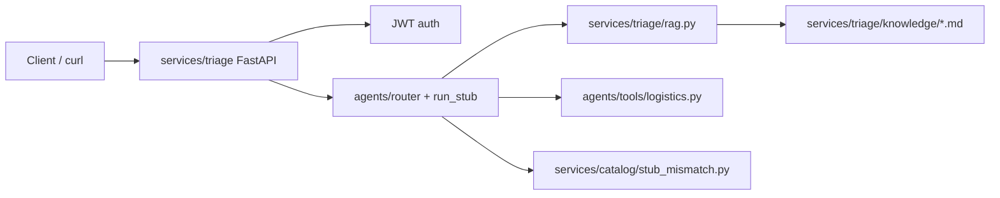

# Architecture

## Diagram

## Module boundaries
- **services/triage:** HTTP boundary (`GET /health`, `POST /token`, `POST /triage`), JWT, validated JSON, Week 8 **pin.json**
- **agents/:** Keyword router from `config.json`; `run_stub` orchestrates stub MVP
- **services/catalog/:** Optional Week 10 lane (stub mismatch only); no triage PII mixed in
- **tests/, evals/:** Unit pyramid, security smoke, golden-set routing eval
- **docs/:** Operator and marker documentation pack

## Data boundaries
- **Clinical / triage teaching data:** `fixtures/triage_messages_sample.jsonl` (~300 rows, synthetic)
- **Marketplace / catalog:** `services/catalog/` only; separate fixtures if extended later
- Agents may route to catalog tools but **must not** merge marketplace records into triage JSONL
